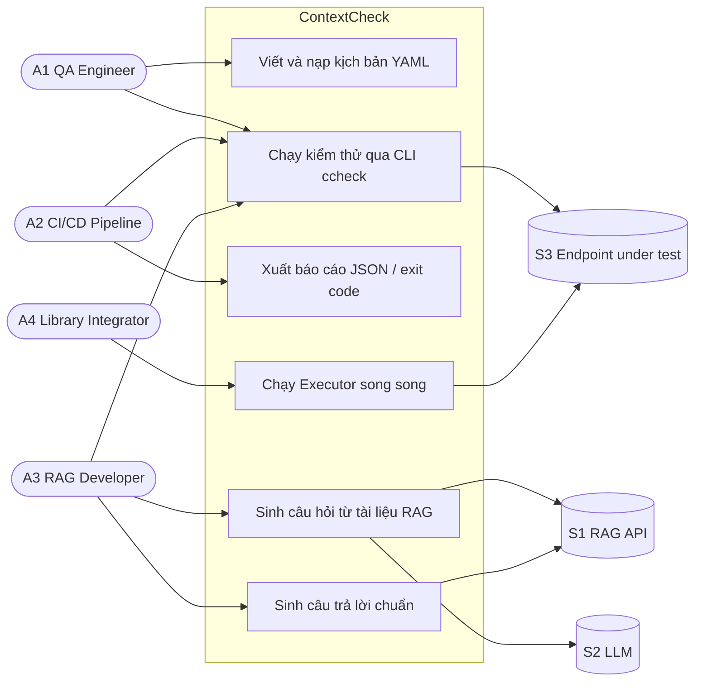

# 1. Phạm vi, actor và phương pháp

## 1.1 Phạm vi được giao

| Hạng mục | Yêu cầu | Tài liệu |
|---|---|---|
| Review code & tài liệu | Kiểm tra logic đọc kịch bản YAML và định tuyến Test Router; đánh giá phương án fallback khi có lỗi | [02](02_REVIEW_YAML_TEST_ROUTER.md) |
| Kiểm thử giao diện & hộp đen | 08 test case CLI; chạy tích hợp toàn trình luồng Q&A; giả lập Retriever trả danh sách rỗng | [03](03_KIEM_THU_CLI_HOP_DEN.md), [04](04_KIEM_THU_E2E_QA.md) |
| Mở rộng | Kiểm thử đa luồng: chạy đồng thời 50 request, kiểm tra deadlock và cấp phát tài nguyên | [05](05_KIEM_THU_DA_LUONG.md) |

**Ngoài phạm vi:** chất lượng câu trả lời của LLM thật (cần khóa API), hiệu năng tải lớn, sửa lỗi.

## 1.2 Actor

ContextCheck là công cụ dòng lệnh kèm thư viện Python, **không có tài khoản hay phân quyền**. Vì vậy "actor" ở đây là **vai trò sử dụng**: ai (hoặc hệ thống nào) tương tác với ContextCheck và bằng cách nào.

### Actor chính (người hoặc hệ thống dùng ContextCheck)

| ID | Actor | Mô tả | Cách tương tác | Điều actor quan tâm |
|---|---|---|---|---|
| **A1** | **QA / Test Engineer** | Viết kịch bản kiểm thử YAML cho LLM/RAG và chạy tay | Viết file `.yaml`, chạy `ccheck --output-type console` | Kịch bản được đọc đúng; lỗi cấu hình phải được báo rõ ràng |
| **A2** | **CI/CD Pipeline** (hệ thống) | Chạy kiểm thử hồi quy tự động sau mỗi lần thay đổi | `ccheck --output-type file --folder ... --exit-on-failure` | **Exit code** đúng, file báo cáo JSON đầy đủ, không crash giữa chừng |
| **A3** | **RAG / AI Developer** | Xây dựng bộ câu hỏi–đáp chuẩn từ dữ liệu RAG để làm bộ regression | Chạy `questions_generator`, `question_answering`, rồi `ccheck` | Luồng Q&A chạy thông, chịu được dữ liệu rỗng |
| **A4** | **Library Integrator** | Nhúng ContextCheck vào code Python, chạy nhiều kịch bản song song | Gọi `TestScenario`, `Executor`, `endpoint.send_request` từ nhiều luồng | An toàn luồng, không deadlock, không lẫn dữ liệu |

### Actor phụ (hệ thống bên ngoài mà ContextCheck gọi tới)

| ID | Hệ thống | Vai trò | Trong test được thay bằng |
|---|---|---|---|
| **S1** | RAG API: Retriever + QA | Trả tài liệu, chunk, kết quả tìm kiếm ngữ nghĩa, câu trả lời | `tests/mock_rag_server.py` (HTTP thật) |
| **S2** | LLM | Sinh câu hỏi; chấm điểm (LLM-as-judge) | Stub `unittest.mock.patch` |
| **S3** | Endpoint under test | Hệ thống đang bị kiểm thử | Endpoint `echo` hoặc route `/cc/qa`, `/echo` của mock server |

### Sơ đồ use case

## 1.3 Ma trận actor × test

| Test | A1 QA | A2 CI/CD | A3 RAG Dev | A4 Integrator |
|---|:-:|:-:|:-:|:-:|
| RV-01 … RV-07: đọc YAML | ● | | | |
| RV-08 … RV-10: định tuyến Router | | ● | | |
| RV-11: cô lập assertion lỗi | ● | ● | | |
| RV-12 … RV-13: fallback khi chạy | | ● | | |
| TC-01 … TC-07: CLI | ● | | | |
| TC-08: CLI ghi file + exit code | | ● | | |
| TC-09: CLI `question_answering` | | | ● | |
| E2E-01 … E2E-06: Q&A toàn trình | | ○ | ● | |
| CC-01 … CC-03: đa luồng | | ○ | | ● |

● = actor chính của test, ○ = actor được hưởng lợi gián tiếp

## 1.4 Phương pháp

| Kỹ thuật | Áp dụng ở đâu |
|---|---|
| **Review code tĩnh** | Đọc `loaders/yaml.py`, `models/models.py`, `executors/tests_router.py`, `executors/executor.py`, `run_tests.py` |
| **Thăm dò (probe)** | Chạy thử các đầu vào biên (YAML rỗng, endpoint chết, retriever rỗng…) để biết hành vi thật trước khi viết test |
| **Kiểm thử hộp đen** | CLI chạy trong **subprocess** đúng như người dùng gõ lệnh; chỉ kiểm tra exit code, stdout/stderr, file đầu ra |
| **Kiểm thử tích hợp** | Gọi qua **HTTP thật** tới mock RAG server, không mock thư viện `requests` |
| **Kiểm thử đồng thời** | `ThreadPoolExecutor` với 50 worker, có timeout để phát hiện deadlock, đếm request song song phía server |

## 1.5 Quy ước

- **Mã test case:** `RV-xx` (review), `TC-xx` (CLI), `E2E-xx` (toàn trình), `CC-xx` (đa luồng).
- **Mã lỗi:** `R` (YAML/Router), `C` (CLI), `E` (E2E), `T` (thread), xem [06](06_DANH_SACH_LOI.md).
- **Trạng thái:**
  - ✅ **Đạt**: hành vi đúng như mong đợi.
  - ❌ **Lỗi (xfail)**: hành vi sai. Test được viết theo **hành vi đúng mong muốn** và đánh dấu `@pytest.mark.xfail(strict=True)`, nên suite vẫn xanh còn lỗi vẫn hiện trong báo cáo. Khi lỗi được sửa, test chuyển thành **XPASS**, suite đỏ, nhắc người sửa gỡ marker. Đây là cách ghi lỗi **có thể kiểm chứng tự động** thay vì chỉ ghi chú.
- **Quan sát:** hành vi có thể gây bất ngờ nhưng không hẳn là lỗi. Được ghi lại bằng test thường (đạt) kèm chú thích.

## 1.6 Môi trường

| Thành phần | Giá trị |
|---|---|
| Hệ điều hành | Linux |
| Python | 3.11 (3.13 không cài được do lockfile ghim `scipy 1.13.1`) |
| Quản lý gói | Poetry, `poetry install` theo `poetry.lock` |
| Test runner | pytest 8 |
| Mạng | Không cần; mọi dịch vụ ngoài chạy tại `127.0.0.1` |
