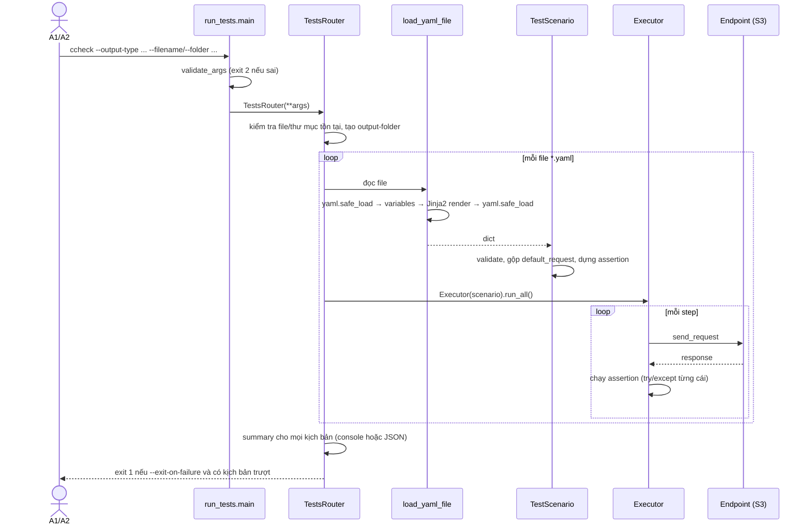

# 2. Review code: đọc kịch bản YAML và Test Router

- **File test:** `tests/test_review_yaml_router.py` (13 test: 9 đạt, 4 xfail)
- **Actor chính:** A1 QA Engineer (đọc YAML), A2 CI/CD Pipeline (định tuyến, fallback)

## 2.1 Mã nguồn đã review

| File | Trách nhiệm |
|---|---|
| `contextcheck/run_tests.py` | Đọc tham số CLI, kiểm tra tổ hợp tham số trong `validate_args` |
| `contextcheck/executors/tests_router.py` | `TestsRouter`: chuẩn hóa đường dẫn, gom kịch bản, chạy từng file, tổng hợp kết quả, quyết định exit code |
| `contextcheck/loaders/yaml.py` | `load_yaml_file`: đọc YAML, lấy `variables`, render Jinja2, parse lại |
| `contextcheck/models/models.py` | `TestScenario`, `TestStep`: validate dữ liệu, gộp `default_request`, dựng assertion |
| `contextcheck/executors/executor.py` | `Executor`: gửi request, chạy assertion, dừng sớm khi có `--exit-on-failure` |

## 2.2 Luồng xử lý



## 2.3 Điểm fallback trong code

| Điểm | Code | Có fallback? |
|---|---|---|
| Tham số CLI sai | `CustomArgumentParser.error`/`validate_args` → in help, exit 2 | ✅ |
| File / thư mục không tồn tại | `field_validator` trong `TestsRouter` → `ValueError` | ✅ (nhưng hiện thành traceback) |
| YAML có `\w` trong nháy kép | `except yaml.scanner.ScannerError` → thông báo hướng dẫn | ✅ |
| YAML sai cú pháp khác (`ParserError`) | không bắt riêng | ⚠️ lỗi gốc PyYAML (vẫn có số dòng) |
| YAML rỗng | không kiểm tra `None` | ❌ R3 |
| Biến Jinja không tồn tại | `Template(...)` mặc định `Undefined` | ❌ R4 (im lặng) |
| Cấu hình sai (`kind`, thiếu `config`) | Pydantic `ValidationError` | ✅ |
| Assertion ném exception | `try/except Exception` trong `Executor._run_step` | ✅ |
| Endpoint lỗi mạng / HTTP | **không có** try/except quanh `send_request` | ❌ R1 |
| Thống kê thời gian sau khi dừng sớm | đọc `step.response` mà không kiểm tra `None` | ❌ R2 |

## 2.4 Cách viết test

Mọi test đều dùng `tmp_path` của pytest để tạo file YAML tạm, nên không phụ thuộc file có sẵn trong repo. Một hàm tiện ích nhỏ dùng chung:

```python
def write(path: Path, content: str) -> Path:
    path.write_text(content)
    return path
```

Kịch bản mẫu dùng endpoint `echo` (trả lại đúng request), nên assertion luôn có kết quả biết trước:

```python
ECHO_SCENARIO = """
config:
  endpoint_under_test:
    kind: echo
steps:
  - name: {name}
    request: {request}
    asserts:
      - kind: contains
        assertion: {request}
"""
```

Ba kiểu kiểm tra được dùng:

1. **Kiểm tra giá trị sau khi nạp:** `TestScenario.from_yaml(file)` rồi so sánh `steps[i].request`.
2. **Kiểm tra lỗi:** `with pytest.raises(LoaiLoi, match="...")`.
3. **Kiểm tra hành vi Router:** gọi `TestsRouter(...).run_tests()` với `output_type="file"`, rồi đọc các file JSON trong thư mục đầu ra.

## 2.5 Chi tiết test case

### Nhóm đọc YAML (actor A1)

| ID | Test | Mục tiêu | Dữ liệu / bước | Mong đợi | Kết quả |
|---|---|---|---|---|---|
| RV-01 | `test_jinja_variables_are_rendered_and_multiline_values_flattened` | Biến Jinja được thay và biến nhiều dòng được nối thành một dòng | `variables: {country: Poland, long_text: "first line\nsecond line"}`; step `"Capital of {{ country }}?"` | `"Capital of Poland?"`, `"Summary: first line second line "` | ✅ |
| RV-02 | `test_default_request_is_merged_into_every_step` | `config.default_request` áp vào mọi step; giá trị riêng của step được ưu tiên | default `parse_response_as_json: true`; step 2 đặt `false` | step 1 = `True`, step 2 = `False` | ✅ |
| RV-03 | `test_double_quoted_regex_gives_friendly_error` | Regex trong nháy kép cho ra thông báo dễ hiểu | `assertion: "\w+"` | `ValueError` chứa "Use single quotes" | ✅ |
| RV-04 | `test_unknown_endpoint_kind_is_rejected_at_load_time` | `kind` không hợp lệ bị chặn ngay lúc nạp | `kind: foo` | `ValidationError` nhắc tới `endpoint_under_test.kind` | ✅ |
| RV-05 | `test_missing_config_section_is_rejected` | Thiếu khối `config` được báo rõ | chỉ có `steps` | `ValidationError` nhắc tới `config` | ✅ |
| RV-06 | `test_empty_yaml_file_gives_clear_error` | File rỗng cần được báo lỗi rõ ràng | file 0 byte | `ValueError`/`ValidationError` | ❌ R3: thực tế `AttributeError` |
| RV-07 | `test_undefined_jinja_variable_is_reported` | Biến Jinja gõ sai tên cần bị báo lỗi | `'{{ typo_var }}'` không khai báo | Lỗi có tên `typo_var` | ❌ R4: thực tế render thành `''` |

Ví dụ code RV-01:

```python
def test_jinja_variables_are_rendered_and_multiline_values_flattened(tmp_path):
    scenario = write(tmp_path / "vars.yaml", """
variables:
  country: Poland
  long_text: |
    first line
    second line
config:
  endpoint_under_test:
    kind: echo
steps:
  - "Capital of {{ country }}?"
  - "Summary: {{ long_text }}"
""")
    ts = TestScenario.from_yaml(scenario)

    assert ts.steps[0].request.message == "Capital of Poland?"
    assert ts.steps[1].request.message == "Summary: first line second line "
```

Ví dụ một lỗi được ghi bằng xfail (RV-07):

```python
@pytest.mark.xfail(strict=True, reason="Undefined Jinja variables silently render as ''")
def test_undefined_jinja_variable_is_reported(tmp_path):
    scenario = write(tmp_path / "undefined.yaml",
        "config:\n  endpoint_under_test:\n    kind: echo\nsteps:\n  - '{{ typo_var }}'\n")

    with pytest.raises(Exception, match="typo_var"):   # hành vi đúng mong muốn
        TestScenario.from_yaml(scenario)
```

### Nhóm định tuyến Router (actor A2)

| ID | Test | Mục tiêu | Dữ liệu / bước | Mong đợi | Kết quả |
|---|---|---|---|---|---|
| RV-08 | `test_router_runs_all_files_and_writes_one_report_each` | Router chạy hết các file trong `--folder`, mỗi file ra một báo cáo | `a.yaml`, `b.yaml`; `output_type="file"` | 2 file JSON `a_*.json`, `b_*.json`, đều `result: true` | ✅ |
| RV-09 | `test_router_folder_only_collects_dot_yaml_files` | Ghi nhận cách gom file | `a.yaml`, `b.yml` | Chỉ có báo cáo của `a` | ✅ *Quan sát:* `.yml` bị bỏ qua mà không cảnh báo |
| RV-10 | `test_router_with_no_scenarios_does_nothing` | Thư mục rỗng không gây crash | thư mục trống | Kết thúc bình thường (chỉ log cảnh báo) | ✅ |

Ví dụ code RV-08:

```python
def test_router_runs_all_files_and_writes_one_report_each(tmp_path):
    scenarios = tmp_path / "scenarios"
    scenarios.mkdir()
    write(scenarios / "a.yaml", ECHO_SCENARIO.format(name="a", request="alpha"))
    write(scenarios / "b.yaml", ECHO_SCENARIO.format(name="b", request="beta"))
    output = tmp_path / "out"

    TestsRouter(output_type="file", folder=scenarios, output_folder=output).run_tests()

    reports = sorted(output.glob("*.json"))
    assert [r.name.split("_")[0] for r in reports] == ["a", "b"]
    assert all(json.loads(r.read_text())["result"] is True for r in reports)
```

### Nhóm fallback khi chạy (actor A1, A2)

| ID | Test | Mục tiêu | Dữ liệu / bước | Mong đợi | Kết quả |
|---|---|---|---|---|---|
| RV-11 | `test_failing_assertion_is_isolated_and_remaining_assertions_run` | Assertion lỗi không làm hỏng các assertion khác | 3 assertion: tên biến không tồn tại; `'1 + 1'` (không phải bool); `contains hello` | Kịch bản `False`; kết quả `[None, None, True]` | ✅ |
| RV-12 | `test_unreachable_endpoint_fails_step_and_run_continues` | Endpoint chết thì chỉ step đó fail, các kịch bản khác vẫn chạy | `a_down.yaml` trỏ `127.0.0.1:9`, `b_ok.yaml` dùng echo | 2 báo cáo JSON | ❌ R1: `ConnectionError` dừng cả lượt chạy, 0 báo cáo |
| RV-13 | `test_time_statistics_after_early_stop` | `--exit-on-failure` kèm `--show-time-statistics` không crash | step 1 trượt, step 2 bị bỏ qua | Ghi báo cáo bình thường | ❌ R2: `AttributeError` vì `step.response is None` |

Với các lỗi có loại exception xác định, test ghi rõ `raises=` để xfail **chỉ** chấp nhận đúng lỗi đó; nếu lỗi đổi sang dạng khác, test sẽ báo đỏ:

```python
@pytest.mark.xfail(
    strict=True, raises=requests.ConnectionError, reason="Endpoint errors abort the whole run"
)
def test_unreachable_endpoint_fails_step_and_run_continues(tmp_path):
    ...
```

## 2.6 Kết luận

- Logic đọc YAML (biến Jinja, `default_request`, dựng assertion) và định tuyến Router **chạy đúng** (RV-01 … RV-05, RV-08 … RV-10).
- Fallback cho **assertion** và cho **cấu hình hoặc tham số sai** được xây dựng **hợp lý** (RV-03 … RV-05, RV-11).
- **Chưa có fallback cho lỗi ở tầng endpoint** (R1). Đây là điểm quan trọng nhất với actor A2: chỉ một endpoint chết là cả pipeline CI dừng mà không có báo cáo nào.
- Có thêm 3 lỗi nhỏ: R2, R3, R4. Chi tiết ở [06_DANH_SACH_LOI.md](06_DANH_SACH_LOI.md).
