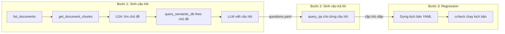

# 4. Kiểm thử tích hợp toàn trình (End-to-End Q&A Flow)

- **File test:** `tests/test_e2e_qa_flow.py` (4 đạt, 2 xfail), dùng `tests/mock_rag_server.py`
- **Actor chính:** A3 RAG / AI Developer. Gián tiếp: A2 CI/CD (chạy bộ regression sinh ra)
- **Hệ thống ngoài:** S1 RAG API (giả lập), S2 LLM (stub)

## 4.1 Luồng Q&A cần kiểm thử

Actor A3 dùng ContextCheck để **tự động xây dựng bộ regression** từ dữ liệu RAG:



| Bước | Thành phần ContextCheck | Gọi tới |
|---|---|---|
| 1 | `QuestionsGenerator` + `ContextClueApiWrapper` | S1 `GET /documents/`, `GET /documents/{id}/`, `POST /semantic_search/get_relevant_documents`; S2 LLM |
| 2 | `AnswerGenerator` + `ContextClueApiWrapper` | S1 `POST /qa/ask` |
| 3 | CLI `ccheck`, endpoint `cc_prompt_llm` | S1 `POST /cc/qa` |

## 4.2 Mock RAG server (`tests/mock_rag_server.py`)

Để test **tích hợp thật qua HTTP** mà không cần dịch vụ ngoài, tôi viết một RAG API giả lập chạy ngay trong tiến trình test:

- Dựa trên `ThreadingHTTPServer` của thư viện chuẩn: mỗi request một luồng, chạy trên cổng ngẫu nhiên tại `127.0.0.1`.
- Có một **kho tri thức** nhỏ: Poland → Warsaw, France → Paris. Câu hỏi khớp từ khóa thì trả câu trả lời và chunk nguồn; không khớp thì trả `"I don't know."`.
- **Trạng thái điều khiển được** từ test (`MockRagState`):

| Thuộc tính | Ý nghĩa |
|---|---|
| `retriever_empty = True` | Giả lập **Retriever trả danh sách rỗng**: semantic search trả `[]`, QA trả `"I don't know."` kèm `collection_retriever_entries: []` |
| `chunks = []` | Tài liệu không có chunk nào |
| `delay = (min, max)` | Độ trễ ngẫu nhiên cho mỗi request (dùng ở test đa luồng) |
| `requests`, `active`, `max_active` | Bộ đếm (có khóa) để đo số request và mức song song |

```python
@contextmanager
def run_mock_rag_server():
    """Start the mock server on a free port; yields (base_url, state)."""
    state = MockRagState()
    server = _Server(("127.0.0.1", 0), _make_handler(state))
    thread = threading.Thread(target=server.serve_forever, daemon=True)
    thread.start()
    try:
        yield f"http://127.0.0.1:{server.server_address[1]}", state
    finally:
        server.shutdown()
        server.server_close()
```

**LLM (S2)** được thay bằng stub, để test không cần khóa API và kết quả xác định được:

```python
STUB_QUESTIONS = "\n".join([
    '{"question": "What is the capital of Poland?"}',
    '{"question": "What is the capital of France?"}',
])

with patch("contextcheck.generators.generate_questions.endpoint_factory") as factory:
    factory.return_value.send_request.return_value.message = STUB_QUESTIONS
    ...
```

**API wrapper** dùng chính class thật `ContextClueApiWrapper`. Vì class này đọc biến môi trường ngay lúc import (lỗi E2), fixture phải đặt biến môi trường trước khi import:

```python
@pytest.fixture
def api_wrapper(rag, monkeypatch):
    base_url, _ = rag
    monkeypatch.setenv("ENDPOINT_BASE_URL", base_url)
    monkeypatch.setenv("HEADER_KEY", "x-api-key")
    monkeypatch.setenv("HEADER_VALUE", "test")
    module = importlib.import_module("contextcheck.generators.cc_api_wrapper")
    return module.ContextClueApiWrapper(
        endpoint_base_url=base_url, header_key="x-api-key", header_value="test", timeout=10
    )
```

## 4.3 Chi tiết test case

| ID | Test | Actor | Kịch bản | Mong đợi | Kết quả |
|---|---|---|---|---|---|
| E2E-01 | `test_e2e_qa_flow` | A3 → A2 | Chạy đủ 3 bước trên RAG bình thường | `questions.yaml` có câu hỏi; câu trả lời Poland là `"Warsaw is the capital of Poland."` kèm tài liệu nguồn `Geography`; `ccheck` exit 0, báo cáo `result: true`, số step bằng số câu hỏi | ✅ |
| E2E-02 | `test_question_generation_with_empty_retriever` | A3 | Bước 1, semantic search trả `[]` | Không crash; LLM vẫn được gọi (prompt không có ngữ cảnh); vẫn có câu hỏi | ✅ |
| E2E-03 | `test_answer_generation_with_empty_retriever` | A3 | Bước 2, `debug=True`, retriever rỗng | Không crash; `answer == "I don't know."`; `chunks_and_documents == []` | ✅ |
| E2E-04 | `test_regression_run_with_empty_retriever_fails_gracefully` | A3, A2 | Bước 3: bộ regression đã có, rồi retriever bị hỏng (rỗng) | Không crash; lỗi hồi quy được **phát hiện** dưới dạng assertion trượt: `result: false`, response `"I don't know."`, exit 0 | ✅ |
| E2E-05 | `test_question_generation_with_document_without_chunks` | A3 | Tài liệu có 0 chunk | Bỏ qua tài liệu đó, trả `questions: []` | ❌ E1: `ValueError: cannot compute LDA over an empty collection` |
| E2E-06 | `test_cc_api_wrapper_importable_without_env` | A3 | `import contextcheck.generators.cc_api_wrapper` khi không có biến môi trường | Import thành công | ❌ E2: `KeyError` lúc import |

### Code E2E-01: luồng toàn trình

```python
def test_e2e_qa_flow(rag, api_wrapper, tmp_path):
    base_url, _ = rag

    # Bước 1: sinh câu hỏi
    questions, _ = generate_questions(api_wrapper, tmp_path / "questions.yaml")
    assert questions[0]["document"] == "Geography"
    assert "What is the capital of Poland?" in questions[0]["questions"]

    # Bước 2: sinh câu trả lời (gọi trực tiếp vì CLI question_answering hỏng, lỗi C1)
    qa = AnswerGenerator(
        api_wrapper=api_wrapper, questions_file=tmp_path / "questions.yaml", debug=True
    ).generate()
    answers = {item["question"]: item for item in qa["QA"][0]["qa"]}
    poland = answers["What is the capital of Poland?"]
    assert poland["answer"] == "Warsaw is the capital of Poland."
    assert poland["chunks_and_documents"][0][0]["document"] == "Geography"

    # Bước 3: dựng kịch bản regression và chạy bằng CLI ccheck
    scenario = tmp_path / "regression.yaml"
    scenario.write_text(build_scenario(qa, base_url))
    result = run_ccheck(scenario, tmp_path / "out")

    assert result.returncode == 0, result.stderr
    report = read_report(tmp_path / "out")
    assert report["result"] is True
    assert len(report["steps"]) == len(qa["QA"][0]["qa"])
```

`build_scenario` biến mỗi cặp hỏi–đáp thành một step với assertion `equals`, gửi tới endpoint `cc_prompt_llm` trỏ vào mock server:

```python
def build_scenario(qa: dict, rag_url: str) -> str:
    steps = [
        {"name": item["question"], "request": item["question"],
         "asserts": [{"kind": "equals", "assertion": item["answer"]}]}
        for entry in qa["QA"] for item in entry["qa"]
    ]
    config = {"endpoint_under_test": {"kind": "cc_prompt_llm", "url": f"{rag_url}/cc/qa"}}
    return yaml.safe_dump({"config": config, "steps": steps})
```

### Code E2E-04: Retriever rỗng ở bước regression

```python
def test_regression_run_with_empty_retriever_fails_gracefully(rag, tmp_path):
    base_url, state = rag
    qa = {"QA": [{"document": "Geography", "qa": [{
        "question": "What is the capital of Poland?",
        "answer": "Warsaw is the capital of Poland."}]}]}
    scenario = tmp_path / "regression.yaml"
    scenario.write_text(build_scenario(qa, base_url))
    state.retriever_empty = True          # ← giả lập Retriever trả danh sách rỗng

    result = run_ccheck(scenario, tmp_path / "out")

    assert result.returncode == 0, result.stderr       # không crash
    report = read_report(tmp_path / "out")
    assert report["result"] is False                   # lỗi hồi quy được phát hiện
    assert report["steps"][0]["response"]["message"] == NO_ANSWER
```

## 4.4 Kết luận

- **Luồng Q&A toàn trình chạy thông** qua HTTP thật: sinh câu hỏi, sinh câu trả lời, rồi chạy regression bằng `ccheck` (E2E-01).
- **Retriever trả danh sách rỗng: luồng không crash** ở cả 3 bước (E2E-02, E2E-03, E2E-04). Ở bước regression, sự cố còn được phát hiện đúng dưới dạng assertion trượt, đúng điều actor A2 cần.
- Giới hạn:
  - Tài liệu không có chunk vẫn làm crash bước sinh câu hỏi (E1).
  - Bước 2 phải gọi trực tiếp `AnswerGenerator` vì CLI `question_answering` đang hỏng (C1).
  - Wrapper đọc biến môi trường ngay lúc import (E2).
